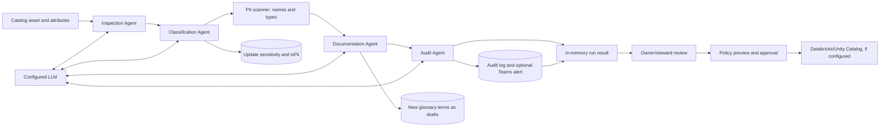

# Lucid Data Governance — Product and Technical Overview

> **English reference document.** Based on a static review of the repository on branch `gestor_portifolio_documento_nexa`, commit `1e45824`. It describes the code paths reviewed; it is not a certification, penetration test, deployment validation or guarantee that integrations are active in a customer environment. Update this document when the product changes.

## 1. Executive summary

Lucid Data Governance is a web application for coordinating data and AI governance processes. Its scope combines a data catalog, dictionary and business glossary; data quality and lineage; privacy and access workflows; committee and demand operations; AI initiative portfolio tracking; AI risk records; MLOps; and LLM-assisted workflows.

The platform is more than a catalog or chatbot. It contains a multi-agent workflow that uses an LLM to support metadata inspection, classification, documentation and audit of data assets; records AI risks and framework checks; and maintains a model register and metrics. Its immediate value is centralizing records, decisions, accountability and operational evidence. External integrations and automation depend on configuration, credentials, permissions and validation in each environment.

**Defensible positioning:** a hybrid operational-governance platform for data and AI, with persisted portal functionality and configurable integration paths. Maturity is heterogeneous: some modules provide real database-backed workflows, some depend on integrations, and some areas are demonstrative. Do not position the product as certified, fully autonomous, automatically compliant or enterprise-ready without the due diligence described below.

## 2. Audience and problems addressed

The platform is intended for data and analytics, technology, security, privacy and compliance teams, data owners, stewards and leaders. It can help organizations reduce fragmentation of definitions and ownership, locate assets, follow data quality and dependencies, record requests and approvals, structure AI initiatives and maintain evidence for review.

Banking, retail and other sector examples in this document are **configurable use cases**, not complete ready-made industry packages. Each implementation must define domains, assets, sources, roles, rules, controls, connectors and success criteria.

## 3. Functional map

### 3.1 Catalog, dictionary, curation and glossary

The catalog stores data assets and attributes, including names, descriptions, source systems, FQNs, domains, sensitivity, criticality, quality scores and owner/steward associations. The dictionary supports attribute descriptions, business rules, PII flags and verification status. The glossary stores terms, definitions, synonyms, examples, notes and workflow states such as draft, review and approved.

Database-backed routes support reading, editing, curation and approval. AI features can suggest tags, descriptions and terms, but a suggestion is not an owner’s approval. Some catalog cards and charts use fixed demonstration values and should not be treated as auditable KPIs.

### 3.2 Lineage and connectors

Lineage is represented as source-to-target edges, transformation rules and, when available, column mappings. The interface renders the graph, supports dependency exploration and calculates downstream impact from persisted edges. SQL and dbt-manifest import paths exist; their results depend on assets already being catalogued and names being resolvable.

The project contains a connector catalog, configuration records, adapters and crawlers for selected sources. A form or connector record does not prove connectivity. Drivers, credentials, permissions, FQNs, warehouses and the route actually invoked must be validated. Coverage varies by source type; fallback and simulated paths exist when integrations are unavailable.

### 3.3 Quality, contracts and SLAs

Quality rules can be configured by dimension and run through `QualityEngine`. Results can be persisted as checks with score, threshold, status and details, and an asset’s quality score can be updated. Actual execution depends on the adapter: the portal adapter evaluates catalog attributes, and the Databricks adapter can run SQL when configured. Some adapters have connection tests but do not yet execute quality checks.

Data contracts record producers, consumers, frequency, SLA, version, status and other metadata. The reviewed code shows a specific guard against renaming an asset with an active contract, but not general contract-schema validation. SLA settings and violations have record/query operations; a complete automated evaluator that checks every threshold and creates violations was not found.

Ticket alerts use locally stored ticket records, domain thresholds and a scheduler. Real email delivery requires SMTP; without credentials, some routes use simulation mode. A local ticket record or external URL does not prove an active ServiceNow synchronization.

### 3.4 Privacy, LGPD, PII and data-subject requests

The privacy portal brings together an LGPD-oriented dashboard and inventory, PIA/DPIA assessments, DSAR records and a PII-policy review queue. The scanner identifies potential personal-data categories from **column names and types**; it does not inspect values or samples. This is heuristic signalling, not proof that data does or does not contain PII.

DSAR and PIA are process records: status, owner, risk, purpose, legal basis, mitigation, deadlines and notes. The DSAR workflow does not automatically execute access, rectification, deletion, portability or objection in source systems. The reviewed code has a mismatch between the deadline shown in the UI and the one calculated by the backend; one policy must be selected and tested.

For Databricks, a preview, approval and synchronization workflow exists for masking, column restrictions and optional RLS policies. Preview only generates SQL; external writes require credentials, permissions, a valid FQN and explicit approval. Local synchronization status should be reconciled with the result of each external command.

### 3.5 Governance operations

Operational modules include domains and participants, a RACI matrix, demand intake and triage, access-approval queues, meetings, agendas, minutes, invitations, role administration and workflows. Many records and state transitions are persisted and selected actions are audited. Teams/Graph, SMTP, webhooks and Databricks grants are available only when the corresponding services are configured.

Some values are user-provided references: a ServiceNow ticket field, Azure DevOps link or meeting URL does not prove integration with those services. Some transitions and checks are enforced only in the interface; backend enforcement must be implemented and tested before treating them as formal controls.

### 3.6 AI initiative portfolio and lifecycle

The portfolio module records initiatives across G0–G3 gates, declared risk, Go/No-Go decisions, checklists and optional evidence links. The UI presents different checklist text by stage and project type. These help organize review and records, but they are largely manual: ServiceNow and Azure DevOps references are not automatically synchronized, and “production/monitoring” labels do not execute deployment or observability.

The reviewed backend uses public procedures for several operations in this module and does not consistently validate gate sequence, checklist completion, evidence or decision-maker role. Authorization and server-side validation need hardening before this workflow is treated as a production control.

### 3.7 AI risk and responsible-AI tracking

The platform records risks by model or model name, with categories for bias, privacy, security, explainability, compliance and operations; level and status; probability and impact; an entered XAI method; and mitigation plan, owner and due date. The score is calculated as probability × impact.

Checks and evidence can be recorded against LGPD, the EU AI Act, ISO 42001 and NIST AI RMF. Users supply the checklist responses; no automation was found that validates a model against these frameworks, runs fairness tests or certifies compliance. Explainability and bias fields are partially modelled, and not all have an interface or operational calculation.

### 3.8 MLOps and LLMOps

The MLOps register persists models, type, framework, user-entered version, owner, lifecycle status and experiment/artifact metadata when supplied. Routes accept accuracy, F1, AUC, drift, prediction count, error rate and latency metrics; drift status is derived from fixed thresholds when a metric is recorded.

A Databricks/MLflow connection can retrieve models and feature signatures when the connector and permissions are configured. This does not mean training, serving, metrics, predictions or billing are ingested automatically. The PSI generation found in the service is demonstrative; the model-promotion UI simulates steps and then changes the local status without deploying a model. Aggregated FinOps figures are fixed values and are not calculated from real prediction logs.

### 3.9 Executive view, maturity, audit and exports

The product includes maturity dashboards, an executive report, audit logs, Databricks audit and export history. Some metrics are calculated from database records. Others are placeholders, untracked zeros, simplified formulas or demonstration data. Databricks audit can run queries and persist sessions/results when access is configured. The audit log is useful operational traceability, but the code does not demonstrate immutability or guaranteed writes under all failure conditions.

## 4. Multi-agent LLM pipeline — technical detail

### 4.1 Overview

The workflow implemented in `server/agentOrchestrator.ts` is **sequential**, with four agents. Each node receives an in-memory state and adds results for the next node. It is not a parallel agent swarm or a general-autonomy mechanism: it is an orchestration with stages and prompts defined in code.

### 4.2 Input and data integration

The governance endpoint accepts `assetId` and optional name, source system, FQN, columns and agent selection. With an `assetId`, the orchestrator queries the database to complete asset metadata. If columns were not provided, the inspection agent loads `data_attributes` with names, types and descriptions. Source-system metadata collection happens outside the orchestrator, through connectors/crawlers and the scheduler; the pipeline consumes what is already available in the catalog.

This distinction matters: running the agents does not mean the orchestrator directly queries every customer database. The described workflow receives catalogued metadata; credentials and access to data sources are required for the separate collection step.

### 4.3 Agent responsibilities

| Stage | Input and processing | Output / persisted effect |
|---|---|---|
| **1. Inspection** | Sends the LLM the asset/table name, source system and columns with types and descriptions. Requests table purpose, business domain, sensitive columns, semantic types and notes in JSON. | Adds an `AgentResult` and metadata to in-memory state. Detailed output is not stored in a dedicated run table. |
| **2. Classification** | Runs `scanTable` over column names/types; passes the PII, risk and suggested-sensitivity summary to the LLM. Requests sensitivity, tags, policies and rationale. | Updates `data_assets.sensitivity` and marks detected attributes `data_attributes.isPii=true`. Tags, policies and rationale remain in the returned state; these changes can precede human review. |
| **3. Documentation** | Sends classification, tags, policies, PII summary and column names/types to the LLM. Requests a Markdown report and glossary terms. | Inserts new, deduplicated terms into `business_glossary` as `draft`, with a `runId` note. `reportMarkdown` remains in the in-memory state/result; no dedicated table stores the complete report. |
| **4. Audit** | Sends sensitivity and PII signals to the LLM. Requests a risk score, compliance status, recommendations and access alerts. | Writes `agent_audit` to `audit_log` when there is an `assetId`; attempts a Teams alert for non-compliance or a high score (≥70), if the webhook is configured. |

### 4.4 PII scanner and data privacy

The native scanner is heuristic: it interprets patterns in column names and types. **It does not read row values.** This limits the input required by the workflow, but it also means false positives and false negatives are possible. An unflagged column is not proof that personal data is absent.

The prompts use business metadata and column names/types; the static review did not identify a redaction/anonymization stage for that metadata before the LLM provider is called. Each deployment should decide which metadata may be sent, configure the provider, and assess retention, region, training use and customer privacy requirements.

### 4.5 LLM, structured output and failure handling

Agents call `invokeLLM` with prompts and `responseFormat: json_object`; the wrapper has configuration paths for compatible providers including Azure OpenAI, Ollama, OpenAI, Gemini and Manus Forge, depending on environment and credentials. Responses are converted with `JSON.parse`; there is no complete semantic-schema validation guaranteeing coherent risk scores, sensitivity or content. Validation, limits, retries and prompt/model versioning should be implemented before relying on outputs for critical processes.

Each agent catches errors and returns a `failed` state; the loop proceeds to later nodes. The result returns completed/failed agents, durations, summary, `runId` and `finalState`. The complete report is not persisted as a run entity, there is no per-asset idempotency/lock, and full traceability of each LLM request/response was not demonstrated. `audit_log` can fail without blocking the workflow, and Teams failures are treated as warnings.

### 4.6 Single-asset, batch and human review

The pipeline can run for one asset or globally. The global routine filters out inactive/deprecated assets and processes them **one at a time**; its internal default limit is 20, while the scheduler passes 10. The scheduler may also call metadata collection, quality checks and PII review. In the reviewed code, the scheduler interval is set to one hour even though a comment says 24 hours; verify and configure it before production use.

Classification and PII flags are not blocked pending human approval. **Databricks policy write-back** follows a separate path: SQL preview, steward review/approval and synchronization using valid host/token/FQN and permissions. That approval gates the external write; it does not certify every LLM inference.

### 4.7 The governance chat is a separate workflow

The governance copilot is a separate route. It builds a specialized prompt, may include context and up to ten recent messages, calls the LLM and writes messages to `ai_chat_history`. The UI keeps the conversation in local state and does not automatically reload the history when opened. The reviewed chat does not use RAG or tools to query the catalog. The customer-application gateway and red-team simulator shown on other screens are simulated and must not be confused with this LLM-based chat.

## 5. Architecture and operations

| Layer | Observed implementation |
|---|---|
| Frontend | React 19, Vite 7, Tailwind CSS 4 and UI components. |
| API | Node.js 22, Express and tRPC 11, plus REST endpoints for health, metrics, public API and authentication. |
| Data | PostgreSQL 16 and Drizzle ORM; schema and migrations in `drizzle/`. |
| Identity | Local authentication with bcrypt and JWT in an HttpOnly cookie; optional SSO/OAuth providers are configuration-dependent. |
| Deployment | Docker Compose, Caddy/HTTPS and volumes; environment configuration and a tested migration process are required. |
| Integrations | LLMs, Databricks/Unity Catalog, data sources, SMTP, Teams/Graph, S3/Azure storage, webhooks and SSO — all conditional. |

Prerequisites in the README are Node.js 22, pnpm 10 and PostgreSQL 16; Docker/Compose is optional for local development. Minimum variables include `DATABASE_URL` and `JWT_SECRET`. The README also documents `APP_DOMAIN`, `APP_PUBLIC_URL`, `STORAGE_PROVIDER` and `PORT`. Each LLM, source or external service needs credentials stored outside the code, permission validation and a real call test in a controlled environment.

Documented project commands include `pnpm install`, `pnpm dev`, `pnpm check`, `pnpm test`, `pnpm build` and `pnpm run smoke`. Before deployment, confirm that the image/container contains the migration/admin scripts invoked by the runbook and test backup and restore in staging.

## 6. Implemented, integration-dependent and demonstrative scope

| State | Examples in the current code | How to describe it |
|---|---|---|
| **Persisted/functional in the portal** | Assets, attributes, glossary, requests, assessments, checks, states, metrics received through routes, selected logs and persisted reports. | “Records”, “organizes” and “tracks status” — when populated records and an operating process exist. |
| **Executable with validated integration** | Crawlers/adapters, LLM, Databricks synchronization/write-back, email, Teams, webhooks, remote storage, SSO and MLflow. | “Can integrate” or “runs when connected/configured”; demonstrate each flow and retain the test result. |
| **Demonstrative or incomplete** | Aggregated FinOps, customer gateway and its response/cost, red-team, visual CI/CD promotion, random PSI, selected charts/KPIs, BI without endpoint, fallback groups and some connector data. | “Demonstration/prototype” or “to be integrated”; never sell it as real consumption, tested security or executed deployment. |

Examples: the FinOps panel contains fixed numbers and does not aggregate actual prediction logs; the gateway returns a simulated answer and calculates fictitious tokens/cost; red-team uses hard-coded rules; model promotion advances on timers and only changes local status; PSI may be random; BI sync without an endpoint generates demonstration figures. Some crawlers also fall back to fixtures when credentials/permissions are missing.

## 7. Expected benefits and measurable pilots

Plausible benefits — to be validated per deployment — include reducing fragmentation of definitions and ownership, making discovery and nominal impact analysis easier, organizing work and approvals, surfacing AI risks and reducing manual documentation effort. The repository contains no customer data, benchmarks or measurements proving percentage financial gains.

### Sector examples

- **Banking:** map customer, transaction and credit assets; assign owners/stewards; track quality and lineage; organize access and model-risk review. Controls and connectors must be defined with the bank.
- **Retail:** organize customer, product, sales, store and inventory data; follow checks and dependencies; prioritize fixes that may affect downstream reports or processes.
- **Any enterprise:** centralize demand and AI initiative intake, record owners, decisions, risks and evidence, and measure the flow through validation.

### Pilot metrics

Select one domain and freeze a baseline, period and inclusion rule before measuring. Useful KPIs based on existing records include:

1. Percentage of critical assets with valid description, owner and steward.
2. Attribute documentation and verification coverage, separating generated suggestions from approved decisions.
3. Number of quality checks executed by source and adapter, and success/warning/failure rates.
4. Valid lineage edges and assets with identified downstream dependencies.
5. Processing time and resolution rate for access requests, demands and DSARs; validate one DSAR deadline policy before measuring.
6. AI projects by gate, risk and decision; evidence completion and human-review completion.
7. Models with owner, framework, version, recent metrics and reconciliation with MLflow.
8. LLM-result review/acceptance rate, PII false positives/negatives and agent failure rate.
9. Tested integrations, failures and data actually collected; exclude mocks, fallbacks and simulation mode.

ROI, cost avoidance and productivity should be measured from customer sources during and after a pilot. Estimated ROI or business-case fields are plans/estimates, not evidence of realized return.

## 8. Technical diligence before enterprise customers

This is a static review, not a penetration test, threat model or independent audit. The following topics should be prioritized before storing customer data at scale:

1. **Authorization and multi-tenancy:** review public/protected procedures, backend role enforcement, owner/steward controls, `organizationId` access, IDOR and data isolation. Several read routes and some portfolio/metadata mutations do not show uniform guards.
2. **Files and secrets:** make uploads/exports private, enforce object-level authorization and signed URLs, review storage of client secrets/configJson and establish credential rotation. Current code may serve `/uploads` publicly and may produce public URLs in remote storage.
3. **Sessions and credentials:** review JWT lifetime/revocation, reset-token storage/expiry, MFA/SSO, password policy and `JWT_SECRET` handling. The README recommends at least 32 secret characters, while parts of the code validate a lower minimum.
4. **Personal data and LLMs:** document metadata classes sent, redaction, regions, retention and provider-training conditions; limit payload logs; decide whether customer data can leave the environment. The scanner does not read data content, but the pipeline sends names and descriptions to the LLM.
5. **LLM governance:** validate output JSON with schemas, version prompts/models, limit calls/costs, add per-run tracing, retries/idempotency, human review and false-positive/negative measurement.
6. **Observability and audit:** make audit-log failures visible, define retention/immutability, distinguish simulated success from real delivery and persist evidence of external executions.
7. **Integrations and workflows:** block gate changes and grants without appropriate authorization, validate sequences/checklists server-side and make sync outcomes reconcilable by command. Review ServiceNow/Azure DevOps paths before saying “integrated”.
8. **Operational readiness:** reconcile README, Dockerfile and runbooks; make migrations fail-fast; validate backup/restore, TLS, alerts, distributed rate limiting, upload limits, environment separation and incident procedures.
9. **Intellectual property:** the repository declares an MIT license and also contains a Votorantim Cimentos S.A. copyright notice. Confirm ownership, use rights, sublicensing and commercial authorization with counsel before offering a license to partners/customers.

## 9. Glossary

- **Data Owner / Data Steward:** business owner / operational data-curation role.
- **PII:** information that can identify a person; current detection is metadata-based and heuristic.
- **FQN:** fully qualified asset name, such as `catalog.schema.table`.
- **RLS / CLS:** row-level security / column-level restriction.
- **Go/No-Go and gates:** project decisions and checkpoints; this module records workflow state, not an automated deployment pipeline.
- **MLOps / LLMOps:** practices and tooling for machine-learning models / LLM applications; a register does not replace telemetry and model operations.
- **Drift:** change in input-data distributions or model performance; indicators must come from real telemetry to support operational decisions.

## 10. Code traceability

Reference files for technical validation (approximate line ranges from the reviewed commit):

- Architecture and setup: `README.md`; `docker-compose.yml`; `server/_core/index.ts`.
- Schema: `drizzle/schema.ts`, especially `data_assets`, `data_attributes`, `data_lineage`, `ai_projects`, `ml_models`, `ai_risk_assessments` and `ai_compliance_checks`.
- Catalog/dictionary/glossary: `client/src/pages/DataCatalog.tsx`, `DataDictionary.tsx`, `Glossario.tsx`; `server/routers.ts`.
- Quality/adapters: `server/qualityEngine.ts`; `server/adapters/`; `server/mlopsRouter.ts`.
- PII and policies: `server/piiScanner.ts`; `server/databricksPolicyService.ts`; `server/metadataScheduler.ts`.
- Pipeline/copilot: `server/agentOrchestrator.ts` (agents at lines 74–466, execution at 513–660); `server/routers.ts` (routes at 1937–1968 and chat at 332–390); `server/_core/llm.ts`.
- Portfolio/gates: `client/src/pages/AIPipeline.tsx`; `server/aiPipelineRouter.ts`.
- MLOps/integration: `client/src/pages/MLOps.tsx`; `server/mlopsRouter.ts`; `server/services/databricks.ts`.
- AI risk: `client/src/pages/RiscosIA.tsx`; `server/aiRiskRouter.ts`; `client/src/lib/complianceTemplates.ts`.
- Executive/audit: `server/executiveMetricsRouter.ts`; `server/auditoria/`; `client/src/pages/ExecutiveReport.tsx`.

---

**Recommended use:** product introduction, pilot scoping and technical diligence. Before sharing externally, verify which integrations are active in the demo environment and review intellectual-property status.