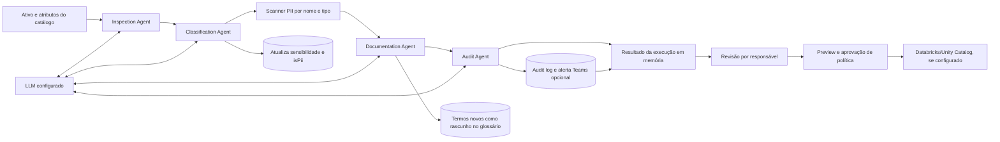

# Lucid Data Governance — Visão funcional e técnica

> **Documento de referência em português.** Baseado em revisão estática do repositório na branch `gestor_portifolio_documento_nexa`, commit `1e45824`. Descreve o código e os fluxos encontrados; não é certificação, pentest, validação de implantação nem garantia de que conectores estejam ativos no ambiente de um cliente. A documentação técnica deve ser atualizada após alterações relevantes no produto.

## 1. Resumo executivo

A Lucid Data Governance é uma aplicação web para coordenar processos de governança de dados e de IA. Sua proposta combina catálogo, dicionário e glossário; qualidade e linhagem; privacidade e gestão de acessos; operação de comitês e demandas; portfólio de iniciativas de IA; registro de riscos; MLOps; e fluxos assistidos por LLM.

O sistema não é apenas um catálogo ou um chatbot. Há um pipeline multiagente que usa um LLM para apoiar a inspeção, classificação, documentação e auditoria de ativos de dados; registros de riscos e verificações de frameworks; e um registro de modelos e métricas. O valor imediato está em centralizar registros, decisões, responsabilidades e evidências operacionais. Integrações e automações externas dependem de configuração, credenciais, permissões e validação de cada ambiente.

**Posicionamento defensável:** uma plataforma híbrida de governança operacional de dados e IA, com funcionalidades persistidas no banco e caminhos de integração configuráveis. A maturidade é heterogênea: existem módulos CRUD e fluxos operacionais reais, módulos condicionados a integrações e áreas ainda demonstrativas. Não apresentar o produto como certificado, plenamente autônomo, automaticamente conforme ou pronto para operação enterprise sem a diligência descrita neste documento.

## 2. Para quem e que problemas aborda

A plataforma atende equipes de dados e analytics, tecnologia, segurança, privacidade, compliance, data owners, stewards e lideranças. Pode ajudar organizações que precisam reduzir a dispersão de definições e responsáveis, localizar ativos, acompanhar qualidade e dependências, registrar pedidos e aprovações, estruturar iniciativas de IA e manter evidências para revisão.

Os exemplos de banco, varejo e outros setores são **casos de uso configuráveis**, não pacotes setoriais completos prontos. Cada implantação precisa definir domínios, ativos, fontes, papéis, regras, controles, conectores e critérios de sucesso.

## 3. Mapa funcional

### 3.1 Catálogo, dicionário, curadoria e glossário

O catálogo mantém registros de ativos e atributos, incluindo nome, descrição, sistema de origem, FQN, domínio, sensibilidade, criticidade, score de qualidade e associações de owner/steward. O dicionário permite descrever atributos, registrar regras de negócio, marcar PII e acompanhar verificação. O glossário mantém termos, definições, sinônimos, exemplos, notas e estados como rascunho, revisão e aprovado.

Há rotas persistidas para leitura, edição, curadoria e aprovação. Recursos de IA podem sugerir tags, descrições e termos, mas sugestão não equivale a aprovação do responsável. Alguns cartões e séries visuais do catálogo são valores fixos de demonstração e não devem ser usados como indicadores auditáveis.

### 3.2 Linhagem e conectores

A linhagem é representada por arestas fonte–destino, regras de transformação e, quando disponíveis, mapeamentos de colunas. A interface renderiza o grafo, permite examinar dependências e calcula impactos downstream a partir das arestas persistidas. Há caminhos de importação de SQL e manifests dbt; a resolução depende de os ativos já estarem catalogados e os nomes serem reconhecíveis.

O projeto inclui catálogo de conectores, configurações, adapters e crawlers para algumas fontes. A existência de um formulário ou registro de conector não comprova conexão. Drivers, credenciais, permissões, FQN, warehouse e rota efetivamente executada precisam ser validados. A cobertura é desigual entre tipos de fonte; existem fallbacks e caminhos simulados quando a integração não está disponível.

### 3.3 Qualidade, contratos e SLAs

Regras de qualidade podem ser configuradas por dimensão e executadas pelo `QualityEngine`. Os resultados podem ser gravados como checks com score, threshold, status e detalhes; o score do ativo pode ser atualizado. A execução efetiva depende do adapter: o portal avalia atributos do catálogo e o Databricks pode executar SQL quando devidamente configurado. Alguns adapters têm teste de conexão, mas ainda não executam checks reais.

Contratos de dados registram produtor, consumidor, frequência, SLA, versão, estado e outros metadados. O código demonstra uma proteção pontual contra renomear um ativo com contrato ativo, mas não a validação geral do schema do contrato. Configurações e violações de SLA têm operações de registro/consulta; não foi encontrado um detector automático completo que avalie todos os limites e crie violações.

O alerta de tickets usa registros locais de tickets, limiares por domínio e um scheduler. Envio real de e-mail depende de SMTP; sem credenciais, algumas rotas operam em modo de simulação. O registro local de ticket ou uma URL externa não comprova sincronização ativa com ServiceNow.

### 3.4 Privacidade, LGPD, PII e solicitações de titulares

O portal reúne dashboard e inventário orientados a LGPD, avaliações PIA/DPIA, DSAR e uma fila de revisão de políticas PII. O scanner identifica possíveis categorias de dados pessoais a partir do **nome e do tipo da coluna**; ele não inspeciona valores ou amostras. Isso é uma sinalização heurística, não uma prova de que o dado contém ou não contém PII.

DSAR e PIA são registros de processo: status, responsável, risco, finalidade, base legal, medidas de mitigação, prazos e notas. O fluxo DSAR não executa automaticamente acesso, retificação, exclusão, portabilidade ou oposição nos sistemas-fonte. O código revisado contém divergência entre o prazo exibido na UI e o prazo calculado no backend; é necessário decidir e testar uma política única.

Para Databricks, existe um fluxo de preview, aprovação e sincronização de políticas de masking, restrição por coluna e RLS opcional. O preview apenas gera SQL; a escrita externa exige credenciais, permissões, FQN válido e aprovação explícita. O status local de sincronização deve ser reconciliado com o resultado de cada comando externo.

### 3.5 Operação de governança

Módulos operacionais incluem domínios e participantes, matriz RACI, intake/triagem de demandas, filas de aprovação de acesso, reuniões, pautas, atas, convites, administração de papéis e workflows. Vários desses registros e estados são persistidos e auditados. Há capacidade de Teams/Graph, SMTP, webhooks e grant Databricks quando os respectivos serviços estão configurados.

Alguns elementos são referências informadas pelo usuário: por exemplo, campos de ticket ServiceNow, link do Azure DevOps ou URL de reunião não comprovam integração com esses serviços. Algumas transições e verificações são aplicadas apenas na interface; antes de usá-las como controle formal, o enforcement precisa ser feito e testado no backend.

### 3.6 Portfólio e ciclo de vida de iniciativas de IA

O módulo de portfólio registra iniciativas em gates G0–G3, risco declarado, decisão Go/No-Go, checklists e links de evidência opcionais. A tela separa listas de critérios por estágio e tipo de projeto. Esses itens ajudam a organizar revisões e registros, mas são principalmente manuais: referências de ServiceNow e Azure DevOps não são sincronizadas automaticamente, e os rótulos de produção/monitoramento não executam deploy ou observabilidade.

O backend revisado usa procedures públicas para várias operações deste módulo e não valida em todos os casos a sequência dos gates, a conclusão dos checklists, a evidência nem o papel do decisor. Esse fluxo precisa de endurecimento de autorização e validação server-side antes de ser tratado como controle de produção.

### 3.7 Gestão de riscos e IA responsável

A plataforma registra riscos por modelo ou nome, com categorias de viés, privacidade, segurança, explicabilidade, conformidade e operação; nível e status; probabilidade e impacto; método XAI informado; plano, responsável e prazo de mitigação. O score é calculado como probabilidade × impacto.

Há registros de checks e evidências associados a LGPD, EU AI Act, ISO 42001 e NIST AI RMF. As perguntas e a resposta de cada verificação são conduzidas pelo usuário; não foi encontrada automação que valide o modelo contra esses frameworks, execute testes de fairness ou certifique conformidade. Campos de explicabilidade e viés estão parcialmente modelados e nem todos têm interface ou cálculo operacional.

### 3.8 MLOps e LLMOps

O registro MLOps persiste modelos, tipo, framework, versão informada, owner, estado do ciclo de vida e metadados de experimentos/artefatos quando preenchidos. Há rotas para métricas de acurácia, F1, AUC, drift, contagem de predições, taxa de erro e latência; o estado de drift é derivado de limiares fixos quando uma métrica é registrada.

A conexão Databricks/MLflow pode buscar modelos e assinaturas de features quando o conector e as permissões estão configurados. Isso não significa que treinamento, serving, métricas, predições ou faturamento sejam automaticamente ingeridos. A geração de PSI encontrada no serviço é demonstrativa; a promoção de modelos na interface simula etapas e depois altera o status local, sem realizar deploy. O painel FinOps agregado retorna dados fixos e não calcula o consumo real a partir dos logs.

### 3.9 Visão executiva, maturidade, auditoria e exportações

Há painéis de maturidade, relatório executivo, audit logs, auditoria Databricks e histórico de exportações. Parte das métricas é calculada sobre registros do banco. Outras são placeholders, zeros sem tracking, fórmulas simplificadas ou dados de demonstração. A auditoria Databricks pode executar consultas e persistir sessões/resultados quando o acesso está configurado. O audit log é uma trilha útil, mas o código não demonstra imutabilidade nem gravação garantida em todas as falhas.

## 4. Pipeline multiagente com LLM — detalhe técnico

### 4.1 Visão geral

O fluxo implementado em `server/agentOrchestrator.ts` é **sequencial**, com quatro agentes. Cada nó recebe um estado em memória e acrescenta resultados para o próximo. Não é um conjunto de agentes concorrentes nem um mecanismo de autonomia geral: é uma orquestração com etapas e prompts definidos no código.

### 4.2 Entrada e integração com os dados

O endpoint de governança recebe `assetId` e, opcionalmente, nome, sistema de origem, FQN, colunas e lista de agentes. Com `assetId`, o orquestrador consulta os ativos do banco para completar metadados. Se a lista de colunas não foi enviada, o agente de inspeção carrega `data_attributes` com nome, tipo e descrição. A coleta de metadados da fonte externa acontece fora do orquestrador, por conectores/crawlers e pelo scheduler; o pipeline consome o que já está disponível no catálogo.

Essa distinção é relevante: executar agentes não equivale a consultar diretamente todos os bancos de dados do cliente. O fluxo descrito recebe metadados catalogados; credenciais e acesso aos dados-fonte são necessários para a etapa separada de coleta.

### 4.3 Responsabilidades dos agentes

| Etapa | Entrada e processamento | Resultado / efeito persistido |
|---|---|---|
| **1. Inspection** | Envia ao LLM nome da tabela/ativo, sistema de origem e lista de colunas com tipo e descrição. Solicita propósito da tabela, domínio de negócio, colunas sensíveis, tipos semânticos e notas em JSON. | Acrescenta `AgentResult` e metadados ao estado em memória. A saída detalhada não é gravada em uma tabela própria de execuções. |
| **2. Classification** | Executa `scanTable` sobre nomes e tipos de colunas; passa ao LLM o resumo de PII, risco e sensibilidade sugerida. Solicita sensibilidade, tags, políticas e justificativa. | Atualiza `data_assets.sensitivity` e marca `data_attributes.isPii=true` para atributos detectados. Tags, políticas e justificativa ficam no estado retornado; a marcação pode ocorrer antes da revisão humana. |
| **3. Documentation** | Envia classificação, tags, políticas, resumo PII e nomes/tipos de colunas. Solicita relatório Markdown e termos de glossário. | Insere termos novos e deduplicados em `business_glossary` como `rascunho`, com anotação de `runId`. `reportMarkdown` permanece no estado/resultado em memória; não há tabela dedicada ao relatório completo. |
| **4. Audit** | Envia sensibilidade e sinais de PII ao LLM. Solicita score de risco, status de conformidade, recomendações e alertas de acesso. | Grava `agent_audit` no `audit_log` quando há `assetId`; tenta alerta Teams em caso não-conforme ou score alto (≥70), se o webhook estiver configurado. |

### 4.4 PII scanner e privacidade do dado enviado ao LLM

O scanner nativo é heurístico: interpreta padrões no nome e no tipo da coluna. **Não lê os valores das linhas**. Isso reduz a entrada necessária ao pipeline, mas também significa que há possíveis falsos positivos e falsos negativos. A ausência de uma coluna marcada não prova ausência de dado pessoal.

Os prompts usam metadados de negócio e nomes/tipos de colunas; a revisão estática não identificou uma etapa de redação/anonimização desses metadados antes de chamar o provedor LLM. Cada implantação deve decidir quais metadados podem ser enviados, configurar o provedor e avaliar retenção, região, uso para treinamento e requisitos de privacidade do cliente.

### 4.5 LLM, saída estruturada e tratamento de falhas

Os agentes chamam `invokeLLM` com prompts e `responseFormat: json_object`; o wrapper tem caminhos de configuração para provedores compatíveis, incluindo Azure OpenAI, Ollama, OpenAI, Gemini e Manus Forge, conforme ambiente e credenciais. A resposta é convertida com `JSON.parse`; não há validação semântica completa por schema que garanta coerência do score, sensibilidade ou conteúdo. É necessário implementar validação, limites, retries e versionamento de prompts antes de depender das saídas em processos críticos.

Cada agente captura erros e devolve estado `failed`; o laço segue para os nós seguintes. O resultado informa agentes concluídos/falhos, durações, resumo, `runId` e `finalState`. O relatório completo não é persistido como uma entidade de execução, não há lock/idempotência por ativo e não foi demonstrada uma trilha completa de cada chamada/resposta do LLM. O `audit_log` pode falhar sem bloquear o fluxo, e falhas de Teams são tratadas como aviso.

### 4.6 Execução por ativo, em lote e revisão humana

O pipeline pode ser acionado para um ativo ou globalmente. A rotina global filtra ativos não inativos/deprecated e processa-os **um a um**; o limite interno padrão é 20, enquanto o scheduler passa 10. O scheduler também pode chamar coleta, qualidade e revisão PII. No código revisado, o intervalo de scheduler está definido como uma hora, apesar de comentário indicar 24 horas; confirmar e configurar antes de qualquer operação produtiva.

A classificação e a marcação PII do catálogo não ficam bloqueadas até aprovação humana. Já o **write-back de políticas ao Databricks** segue um fluxo separado: preview de SQL, revisão/aprovação por steward e sync com host/token/FQN e permissões válidos. Esta aprovação protege a escrita externa; não certifica que toda inferência do LLM esteja correta.

### 4.7 Chat de governança é um fluxo diferente

O copiloto de governança é outra rota. Ele monta um prompt especializado, pode incluir contexto e até dez mensagens recentes, chama o LLM e grava mensagens em `ai_chat_history`. A interface mantém as mensagens em estado local e não reidrata automaticamente o histórico ao abrir a tela. O chat não executa RAG ou ferramentas para consultar o catálogo no fluxo revisado. O gateway de aplicação de cliente e o simulador de red-team vistos em outras telas são simulados e não devem ser confundidos com este chat baseado em LLM.

## 5. Arquitetura e operação

| Camada | Implementação observada |
|---|---|
| Frontend | React 19, Vite 7, Tailwind CSS 4 e componentes de interface. |
| API | Node.js 22, Express e tRPC 11, mais endpoints REST para health, métricas, API pública e autenticação. |
| Dados | PostgreSQL 16 e Drizzle ORM; schema e migrações no diretório `drizzle/`. |
| Identidade | Autenticação local com bcrypt e JWT em cookie HttpOnly; provedores SSO/OAuth opcionais, sujeitos a credenciais e validação. |
| Implantação | Docker Compose, Caddy/HTTPS e volumes; configuração requer variáveis de ambiente e um processo de migração testado. |
| Integrações | LLM, Databricks/Unity Catalog, fontes de dados, SMTP, Teams/Graph, armazenamento S3/Azure, webhooks e SSO — todas condicionais. |

Pré-requisitos declarados no README: Node.js 22, pnpm 10 e PostgreSQL 16; Docker/Compose é opcional para desenvolvimento local. Variáveis mínimas incluem `DATABASE_URL` e `JWT_SECRET`. O README também descreve `APP_DOMAIN`, `APP_PUBLIC_URL`, `STORAGE_PROVIDER` e `PORT`. Para cada LLM, fonte ou serviço externo, é preciso registrar credenciais fora do código, validar permissões e testar a chamada real em ambiente controlado.

Comandos documentados pelo projeto incluem `pnpm install`, `pnpm dev`, `pnpm check`, `pnpm test`, `pnpm build` e `pnpm run smoke`. Antes de uma implantação, confirmar que a imagem/container inclui os scripts de migração/admin invocados pelo runbook e testar backup e restore em staging.

## 6. O que está implementado, depende de integração ou é demonstrativo

| Estado | Exemplos no código atual | Como comunicar |
|---|---|---|
| **Persistido/funcional no portal** | Ativos, atributos, glossário, pedidos, avaliações, checks, estados, métricas recebidas por rotas, logs selecionados e relatórios persistidos. | “Registra”, “organiza”, “acompanha o estado” — quando há registros e processo operacional. |
| **Executável com integração validada** | Crawlers/adapters, LLM, sincronização e write-back Databricks, e-mail, Teams, webhooks, storage remoto, SSO e MLflow. | “Pode integrar” ou “executa quando conectado/configurado”; demonstrar cada fluxo e guardar resultado do teste. |
| **Demonstrativo ou incompleto** | FinOps agregado, gateway de cliente e sua resposta/custos, red-team, promoção CI/CD visual, PSI aleatório, alguns gráficos/KPIs, BI sem endpoint, grupos fallback e certos dados de conectores. | “Demonstração/protótipo” ou “a integrar”; nunca vender como consumo real, segurança testada ou deploy executado. |

Exemplos específicos: o painel FinOps contém números fixos e não soma o histórico real de predições; o gateway devolve resposta simulada e calcula tokens/custo fictícios; o red-team usa regras hard-coded; a promoção de modelo avança por temporizadores e apenas altera status; o PSI pode ser aleatório; o sync BI sem endpoint gera números de demonstração. Alguns crawlers também têm fallback para fixtures quando faltam credenciais/permissões.

## 7. Benefícios esperados e pilotos mensuráveis

Benefícios plausíveis — a validar por implantação — incluem reduzir a dispersão de definições e responsáveis, facilitar descoberta e impacto nominal, organizar pendências e aprovações, dar visibilidade a riscos de IA e reduzir trabalho manual de documentação. Não há no repositório dados de clientes, benchmarks ou medições que provem ganhos financeiros percentuais.

### Exemplos por setor

- **Banco:** mapear ativos de cliente, transação e crédito; associar owners/stewards; acompanhar regras de qualidade e linhagem; organizar revisão de acesso e riscos de modelos. Políticas e conectores precisam ser definidos com o banco.
- **Varejo:** organizar dados de cliente, produto, venda, loja e estoque; acompanhar checks e dependências; priorizar correções que podem afetar relatórios ou processos a jusante.
- **Empresa em geral:** centralizar intake de demandas e iniciativas de IA, registrar responsáveis, decisões, riscos e evidências e medir o fluxo até a validação.

### Indicadores para um piloto

Escolher um domínio e congelar baseline, período e regra de inclusão antes de medir. KPIs úteis com registros existentes incluem:

1. Percentual de ativos críticos com descrição, owner e steward válidos.
2. Cobertura de atributos com descrição e verificação, separando sugestões automáticas de decisões aprovadas.
3. Quantidade de checks de qualidade executados, por origem e adapter, e proporção de sucesso/alerta/falha.
4. Arestas de linhagem válidas e ativos com dependências downstream identificadas.
5. Tempo de tramitação e taxa de resolução de pedidos de acesso, demandas e DSAR; validar a política de prazo DSAR antes de usar o KPI.
6. Projetos de IA por gate, risco e decisão; evidências preenchidas e revisões humanas concluídas.
7. Modelos com owner, framework, versão, métricas recentes e integração reconciliada com MLflow.
8. Taxa de resultados LLM revisados/aceitos, falsos positivos/negativos de PII e falhas por agente.
9. Integrações testadas, falhas e dados efetivamente coletados; excluir mocks, fallbacks e simulation-mode.

ROI, custo evitado e produtividade devem ser medidos por fontes do cliente durante e depois do piloto. Campos de estimated ROI ou business case são estimativas/plano, não prova de retorno realizado.

## 8. Diligência técnica antes de clientes enterprise

A revisão é estática e não substitui pentest, threat modeling ou auditoria independente. Os seguintes temas devem virar backlog prioritário antes de armazenar dados de cliente em escala:

1. **Autorização e multi-tenancy:** revisar procedures públicas/protegidas, enforcement por papel no backend, controle de owner/steward, acesso por `organizationId`, IDOR e isolamento de dados. Várias rotas de leitura e algumas mutações de portfolio/metadata não demonstram guardas uniformes.
2. **Arquivos e segredos:** tornar uploads/exports privados, aplicar autorização por objeto e URLs assinadas, revisar armazenamento de client secrets/configJson e estabelecer rotação de credenciais. O código atual pode servir `/uploads` publicamente e pode produzir URLs públicas em storage remoto.
3. **Sessões e credenciais:** revisar duração e revogação de JWT, armazenamento e expiração de tokens de reset, MFA/SSO, política de senha e tratamento de `JWT_SECRET`. O README recomenda segredo de pelo menos 32 caracteres, enquanto parte do código valida um mínimo menor.
4. **Dados pessoais e LLM:** documentar classes de metadados enviadas, redaction, regiões, retenção e condições de treinamento do provedor; limitar logs de payload; decidir se dados do cliente podem sair do ambiente. O scanner não lê conteúdo, mas o pipeline envia nomes e descrições ao LLM.
5. **Governança do LLM:** validar JSON de saída com schemas, versionar prompts/modelos, limitar chamadas/custos, acrescentar trilha por run, retries/idempotência, revisão humana e medição de falsos positivos/negativos.
6. **Observabilidade e auditoria:** tornar falhas de audit log visíveis, definir retenção/imutabilidade, separar sucesso simulado de entrega real e persistir evidências de execuções externas.
7. **Integrações e workflows:** bloquear gravações de gate e grants sem autorização adequada, validar sequência/checklists no servidor e tornar sincronização reconciliável por comando. Revisar os caminhos de ServiceNow/Azure DevOps antes de usar a palavra “integrado”.
8. **Prontidão operacional:** reconciliar README, Dockerfile e runbooks; aplicar migrações de modo fail-fast; validar backup/restore, TLS, alertas, rate limiting distribuído, limites de upload, segregação de ambientes e procedimentos de incidente.
9. **Direitos de propriedade intelectual:** o repositório declara licença MIT e também traz copyright de Votorantim Cimentos S.A. Confirmar titularidade, direitos de uso, sublicenciamento e autorização comercial com assessoria jurídica antes de prometer uma licença a parceiros/clientes.

## 9. Glossário

- **Data Owner / Data Steward:** responsável de negócio / responsável operacional pela curadoria de dados.
- **PII:** informações que podem identificar uma pessoa; a detecção atual é heurística por metadados.
- **FQN:** nome totalmente qualificado de ativo, como `catalog.schema.table`.
- **RLS / CLS:** segurança em nível de linha / restrição em nível de coluna.
- **Go/No-Go e gates:** decisões e checkpoints do ciclo do projeto; neste módulo são registros/workflows, não pipeline automático de deploy.
- **MLOps / LLMOps:** práticas e ferramentas para organizar modelos de machine learning / aplicações com LLM; os registros não substituem telemetria e operação do modelo.
- **Drift:** mudança na distribuição de dados ou desempenho de um modelo; indicadores devem vir de telemetria real para sustentar decisões.

## 10. Rastreabilidade no código

Arquivos de referência para validação técnica (faixas aproximadas na revisão do commit acima):

- Arquitetura e setup: `README.md`; `docker-compose.yml`; `server/_core/index.ts`.
- Schema: `drizzle/schema.ts`, em especial `data_assets`, `data_attributes`, `data_lineage`, `ai_projects`, `ml_models`, `ai_risk_assessments` e `ai_compliance_checks`.
- Catálogo/dicionário/glossário: `client/src/pages/DataCatalog.tsx`, `DataDictionary.tsx`, `Glossario.tsx`; `server/routers.ts`.
- Qualidade/adapters: `server/qualityEngine.ts`; `server/adapters/`; `server/mlopsRouter.ts`.
- PII e políticas: `server/piiScanner.ts`; `server/databricksPolicyService.ts`; `server/metadataScheduler.ts`.
- Pipeline e copiloto: `server/agentOrchestrator.ts` (agentes em linhas 74–466, execução em 513–660); `server/routers.ts` (rotas em 1937–1968 e chat em 332–390); `server/_core/llm.ts`.
- Portfolio e gates: `client/src/pages/AIPipeline.tsx`; `server/aiPipelineRouter.ts`.
- MLOps e integração: `client/src/pages/MLOps.tsx`; `server/mlopsRouter.ts`; `server/services/databricks.ts`.
- Riscos de IA: `client/src/pages/RiscosIA.tsx`; `server/aiRiskRouter.ts`; `client/src/lib/complianceTemplates.ts`.
- Executivo/auditoria: `server/executiveMetricsRouter.ts`; `server/auditoria/`; `client/src/pages/ExecutiveReport.tsx`.

---

**Uso recomendado:** introdução comercial, alinhamento de escopo de piloto e diligência técnica. Antes de encaminhar externamente, confirmar integrações ligadas no ambiente de demonstração e revisar o status de propriedade intelectual.